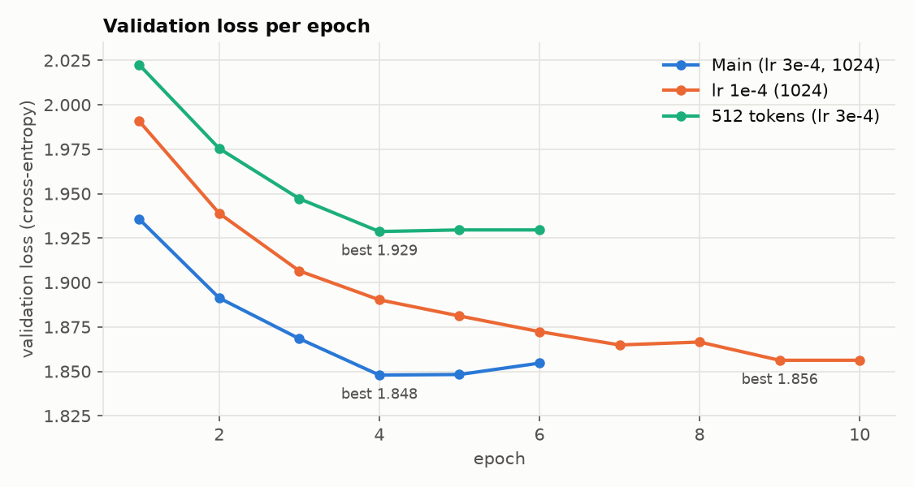
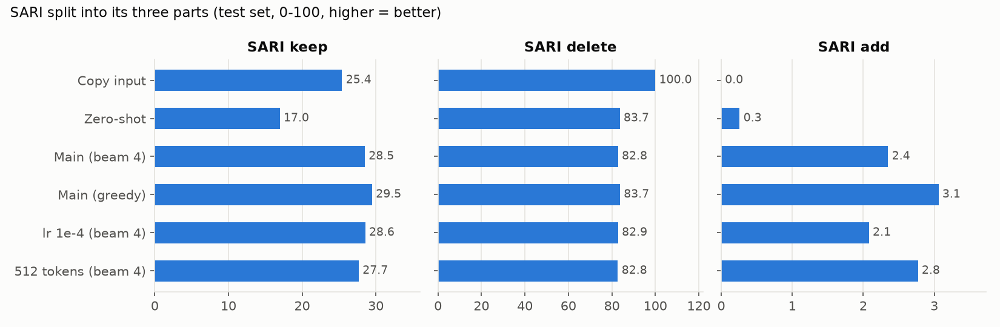
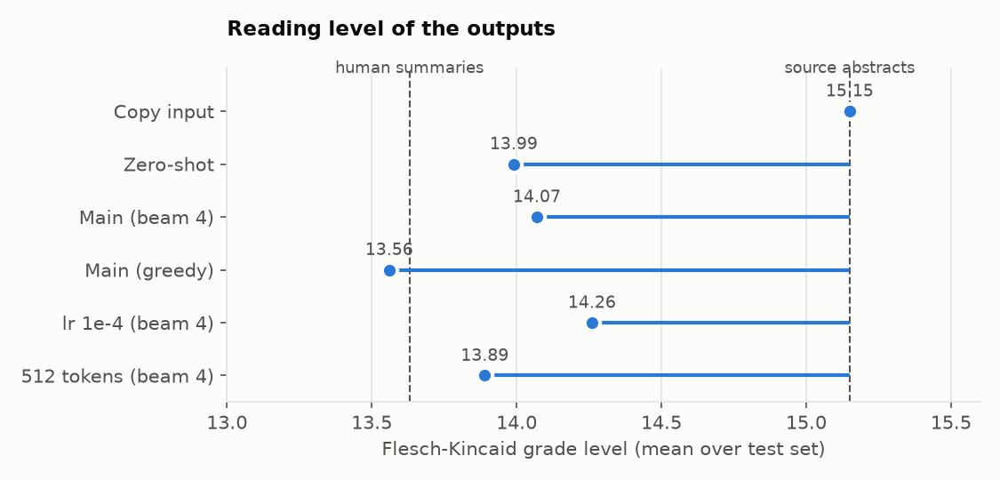
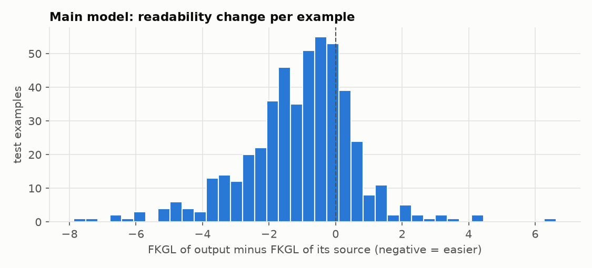
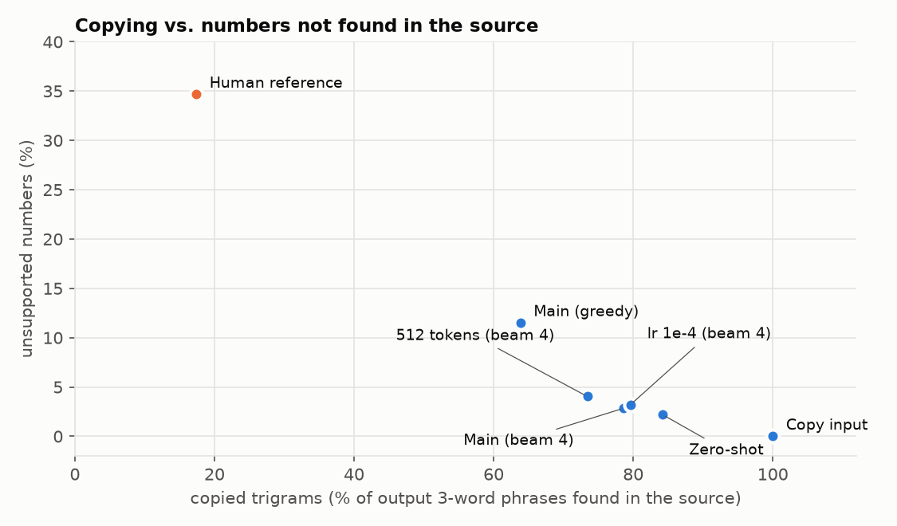
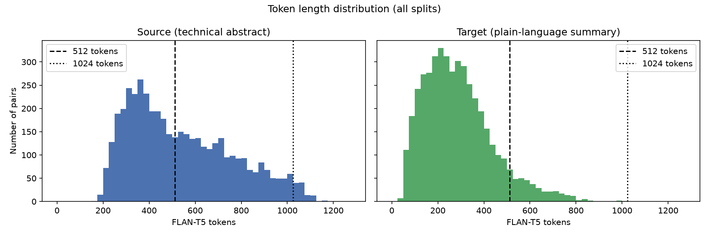
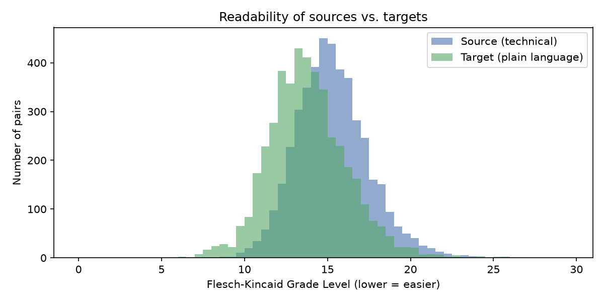

# Medical Text Simplifier

Rewrites medical research text (abstracts written for doctors and scientists) into plain language that patients can understand, by fine-tuning a pre-trained Transformer (`google/flan-t5-base`) on the Cochrane plain-language-summary dataset.

Course project: generative modeling in NLP, grade-5 tier. See [docs/REQUIREMENTS.md](docs/REQUIREMENTS.md) for the requirements and [docs/PROGRESS.md](docs/PROGRESS.md) for the step-by-step log.

## At a glance
| | |
|---|---|
| Task | Paragraph-level simplification: medical review abstract → plain-language summary |
| Model | `google/flan-t5-base` (250M parameters, encoder-decoder Transformer), fully fine-tuned |
| Data | Cochrane abstracts paired with plain-language summaries: 3,567 train / 411 validation / 480 test |
| Training | 3 runs on Google Colab (T4 GPU): main configuration + learning-rate and input-length variations |
| Evaluation | SARI (and its keep / delete / add parts), BLEU, ROUGE, FKGL readability, plus two added measures: copied trigrams and numbers not found in the source |
| Demo | Local Gradio app with readability statistics and a warning for numbers not found in the input |

**Main findings** (test set; details in [docs/PROGRESS.md](docs/PROGRESS.md), Phase 6):
- Fine-tuning clearly improves on the untrained model: SARI 37.9 vs. 33.6 (bootstrap 95% interval of the difference +3.7 to +4.8), BLEU 14.8 vs. 0.5, and outputs of summary length.
- The reading level drops by about one grade (FKGL 15.15 → 14.07), which closes about 70% of the gap to the human summaries. 77% of outputs are easier to read than their source.
- The model simplifies mainly by **selecting and shortening**: 79% of its 3-word phrases are copied from the source, against 17% for the human writers.
- **Copying the input scores the highest SARI (41.8)**, because the SARI implementation gives a perfect deletion score to a system that deletes nothing. On the keep and add parts of SARI, the fine-tuned model beats copying.
- **Learning rate 3e-4 beat 1e-4**, and reading the full abstract (1024 tokens) beat cutting it at 512. On long abstracts the cut causes more numbers that are not in the source.
- **Greedy decoding** reads easier and scores slightly higher SARI, but writes 4 times as many numbers that are not in the source, so beam search is the default.

**Project report:** [docs/REPORT.md](docs/REPORT.md) covers the data, training methodology, hyperparameters tried and their effect, results and discussion. All phases (0–8) are complete; [docs/PROGRESS.md](docs/PROGRESS.md) logs each step, decision and result.

## Figures
All figures are produced by [notebooks/04_results.ipynb](notebooks/04_results.ipynb) (training and test results) and [notebooks/01_data_exploration.ipynb](notebooks/01_data_exploration.ipynb) (data), and saved in [docs/figures/](docs/figures/).

**Training: validation loss of the three runs.** The main run (lr 3e-4, 1024-token inputs) reaches the lowest loss at epoch 4; cutting inputs to 512 tokens is clearly worse.



**SARI split into its three parts.** Copying the input wins only through a free deletion score; the fine-tuned models win on keep and add.



**Reading level.** Every system's FKGL, measured from the source abstracts (15.15) toward the human summaries (13.63).



**Readability change per test example** for the main model (negative = easier than its source).



**Copying vs. numbers not found in the source.** The model copies far more than the human writers; greedy decoding copies less but invents more numbers.



**Data:** token lengths of abstracts and summaries, and readability of source vs. target.






## Setup (macOS / Linux)
```bash
python3 -m venv .venv
source .venv/bin/activate
pip install -r requirements.txt
python scripts/check_env.py   # should end with "Environment ready."
```
On Google Colab, PyTorch is preinstalled with CUDA; the Colab notebook installs every other package from `requirements.txt`.

## Data
The processed splits are already in `data/processed/` (`train` 3,567, `val` 411, `test` 480 pairs; JSONL with `id`, `source`, `target`). To rebuild them from the authors' repository (pinned commit) and re-check them:
```bash
python -m src.data.download
```
```bash
python -m src.data.validate
```
Exploration: [notebooks/01_data_exploration.ipynb](notebooks/01_data_exploration.ipynb).

Dataset: Devaraj et al., *Paragraph-level Simplification of Medical Texts*, NAACL 2021 — [GitHub](https://github.com/AshOlogn/Paragraph-level-Simplification-of-Medical-Texts), CC BY 4.0.

## Tests
```bash
python -m pytest -q tests
```

## Baselines (no training)
```bash
python -m src.eval.baselines --which copy
```
```bash
python -m src.eval.baselines --which zeroshot
```
Results go to `runs/baseline_copy/` and `runs/baseline_zeroshot/` (`config.json`, `predictions.jsonl`, `metrics.json`).

## Training
All settings live in a YAML file in `configs/`. Quick end-to-end check on a Mac (200 pairs, 1 epoch, ~4 min):
```bash
python -m src.train --config configs/smoke_mac.yaml
```
Full training (meant for a Colab GPU; checkpoints go to `--output-dir`, default `./checkpoints`):
```bash
python -m src.train --config configs/base.yaml --output-dir /content/drive/MyDrive/medical-text-simplifier/checkpoints
```
Add `--resume` to continue an interrupted run, and `--runs-dir` to choose where the small run files go.

**On Google Colab:** open [notebooks/02_train_colab.ipynb](notebooks/02_train_colab.ipynb) ([Open in Colab](https://colab.research.google.com/github/sissikhaled/medical-text-simplifier/blob/main/notebooks/02_train_colab.ipynb)), choose the T4 GPU runtime, pick a config in the Settings cell and *Run all*. Checkpoints and run files are saved to Google Drive, and an interrupted run resumes automatically.

| Config | Run name | What changes | Best val. loss |
|---|---|---|---|
| `configs/base.yaml` | `flan-t5-base_lr3e-4_src1024` | main run | **1.848** |
| `configs/lr1e-4.yaml` | `flan-t5-base_lr1e-4_src1024` | learning rate 1e-4 | 1.856 |
| `configs/src512.yaml` | `flan-t5-base_lr3e-4_src512` | inputs truncated to 512 tokens | 1.929 |

Small outputs (config, loss CSV and plot, summary, validation samples) go to `runs/<run_name>/`; model weights never go into git.

## Evaluation on the test set
Needs a trained model: the run's `best/` folder from Google Drive (`MyDrive/medical-text-simplifier/checkpoints/<run_name>/best`, about 1 GB). Put it in `models/<run_name>/` (ignored by git), then:
```bash
python -m src.evaluate_model --run flan-t5-base_lr3e-4_src1024 --model-dir models/flan-t5-base_lr3e-4_src1024
```
Add `--decoding greedy` for the decoding comparison and `--limit 8` for a quick check. Results go to `runs/<run_name>/test_<decoding>/` (`predictions.jsonl`, `metrics.json`, `config.json`). Progress is saved every 20 examples, so the same command continues an interrupted evaluation. On a Mac, prefix it with `caffeinate -i` so the computer does not sleep.

On Colab: [notebooks/03_evaluate_colab.ipynb](notebooks/03_evaluate_colab.ipynb) ([Open in Colab](https://colab.research.google.com/github/sissikhaled/medical-text-simplifier/blob/main/notebooks/03_evaluate_colab.ipynb)) reads the model straight from Drive.

After a change to the metric code, recompute saved results without generating again:
```bash
python -m src.eval.rescore runs/baseline_copy runs/baseline_zeroshot
```

### Results (test set, 480 pairs)
| System | SARI | FKGL ↓ | Words | Copied trigrams % | Numbers not in source % |
|---|---|---|---|---|---|
| Copy input | 41.8 | 15.15 | 350 | 100 | 0 |
| Zero-shot FLAN-T5-base | 33.6 | 13.99 | 44 | 84 | 2.2 |
| **Fine-tuned, main run (beam 4)** | 37.9 | 14.07 | 184 | 79 | 2.8 |
| Fine-tuned, main run (greedy) | 38.8 | 13.56 | 205 | 64 | 11.5 |
| Human summaries | – | 13.63 | 215 | 17 | 35 |

Fine-tuning beats the zero-shot model on every measure and lowers the reading level by about one grade. It simplifies mostly by selecting and shortening rather than rewriting. Copying the input scores higher SARI only because SARI gives a perfect deletion score to a system that deletes nothing. Full table, significance tests, figures and examples: [notebooks/04_results.ipynb](notebooks/04_results.ipynb) and [docs/PROGRESS.md](docs/PROGRESS.md).

## Demo (Gradio, runs locally)
Needs the main run's model in `models/flan-t5-base_lr3e-4_src1024/` (the `best/` folder from Google Drive; either `models/<run>/` or `models/<run>/best/` works). Then:
```bash
python -m app.app
```
Open http://127.0.0.1:7860, paste medical text (or click one of the test-set examples) and press **Simplify**. A 350-word abstract takes a few seconds to about 30 seconds on an M2 Mac. The app shows:
- the plain-language version;
- word counts and reading grade (FKGL) of the input and output;
- a warning listing any numbers in the output that do not appear in the input.

Beam search is the default. Greedy decoding is faster but invents numbers more often. The model was trained on research abstracts: on short clinical notes it mostly copies or drops sentences. **It is a research demo, not medical advice.**

## Reproducing everything, in order
1. Setup and tests (above).
2. Data: `python -m src.data.download` and `python -m src.data.validate` (optional: the processed splits are committed).
3. Baselines: `python -m src.eval.baselines --which all` (the zero-shot baseline takes about 35 min on an M2 Mac).
4. Training: notebook 02 on Colab, once per config in `configs/` (2.5–6 GPU hours each on a T4).
5. Test evaluation: notebook 03 on Colab (or `src/evaluate_model.py` locally), for each run, plus `--decoding greedy` for the main run.
6. Analysis: [notebooks/04_results.ipynb](notebooks/04_results.ipynb) (reads only committed files; runs in seconds).
7. Demo: `python -m app.app`.

Training is seeded (seed 42), but GPU kernels are not bit-for-bit deterministic, so a retrained model can differ slightly. The committed predictions are the ones all reported numbers come from.

## Project structure
```
configs/          training settings, one YAML per run (+ smoke_mac.yaml for a quick Mac test)
data/processed/   train / val / test pairs (JSONL), built by src/data/download.py
src/data/         download, validation, text normalization and tokenization
src/eval/         metrics, readability (FKGL), baselines, rescoring
src/train.py      fine-tuning with the Hugging Face Seq2SeqTrainer
src/generate.py   shared text generation (beam search / greedy)
src/evaluate_model.py   test-set generation and scoring (resumable)
app/app.py        Gradio demo
notebooks/        01 data exploration, 02 training (Colab), 03 evaluation (Colab), 04 results
runs/             per-run outputs: configs, loss logs and plots, validation samples, test predictions and metrics
docs/             report, requirements, progress log, results tables, figures
tests/            unit tests (pytest)
models/, checkpoints/   model weights (not in git; ~1 GB per model on Google Drive)
```

## Limitations
- The model mostly selects and shortens sentences; it rarely replaces jargon with plain words, and its outputs stay at university reading level (as do the human summaries).
- It can drop facts, change numbers or units, and misspell rare drug names (examples in PROGRESS, Phase 6). The demo's number check catches only invented numbers, not other errors.
- A third of the numbers in the human summaries are not in the abstracts (the summaries were written from the full reviews), so the training data partly rewards writing facts that are not in the input.
- It was trained on Cochrane review abstracts only; on clinical notes (diagnoses, prescriptions) it does not work well.
- The evaluation is automatic (one reference per abstract). FKGL measures sentence and word length, not understanding, and no human judged the outputs.

## Credits
- Dataset: Ashwin Devaraj, Iain Marshall, Byron Wallace and Junyi Jessy Li, *Paragraph-level Simplification of Medical Texts*, NAACL 2021 ([repository](https://github.com/AshOlogn/Paragraph-level-Simplification-of-Medical-Texts), CC BY 4.0). The texts come from Cochrane systematic reviews.
- Model: FLAN-T5 (Chung et al., *Scaling Instruction-Finetuned Language Models*, 2022), `google/flan-t5-base` on Hugging Face.
- SARI: Xu et al., *Optimizing Statistical Machine Translation for Text Simplification*, TACL 2016 (Hugging Face `evaluate` implementation).

## License
The code is released under the [MIT License](LICENSE). The Cochrane data in `data/processed/` keeps its original CC BY 4.0 license (see Credits).
