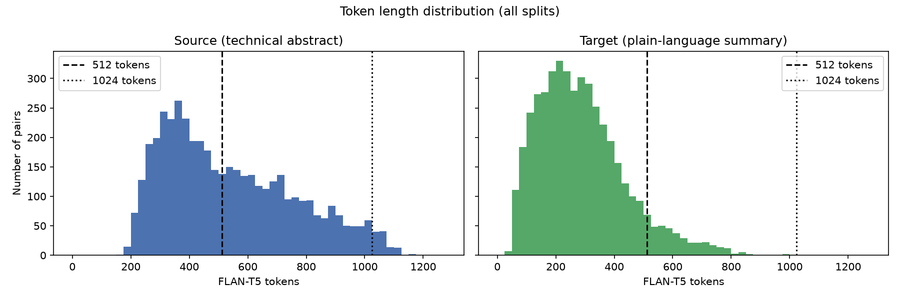
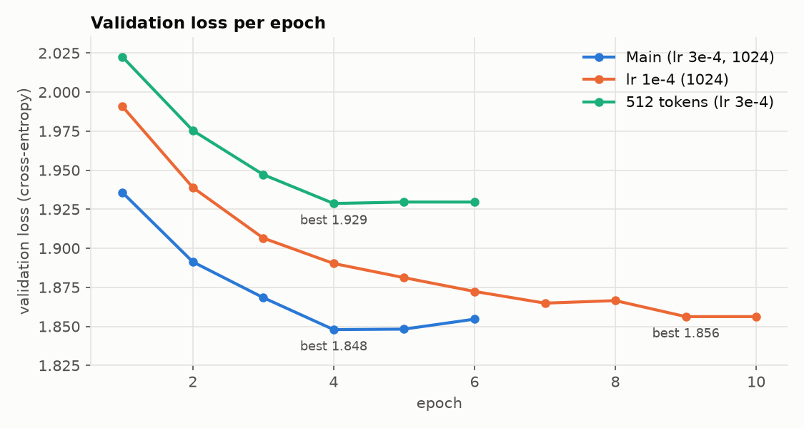
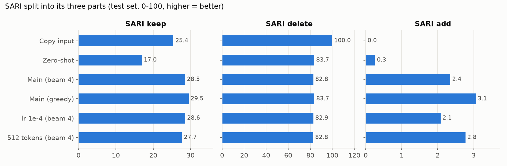
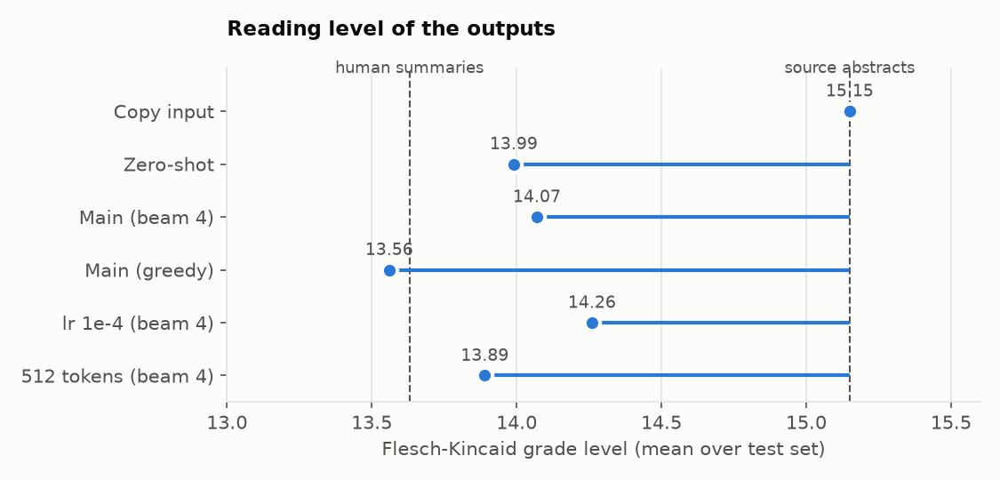
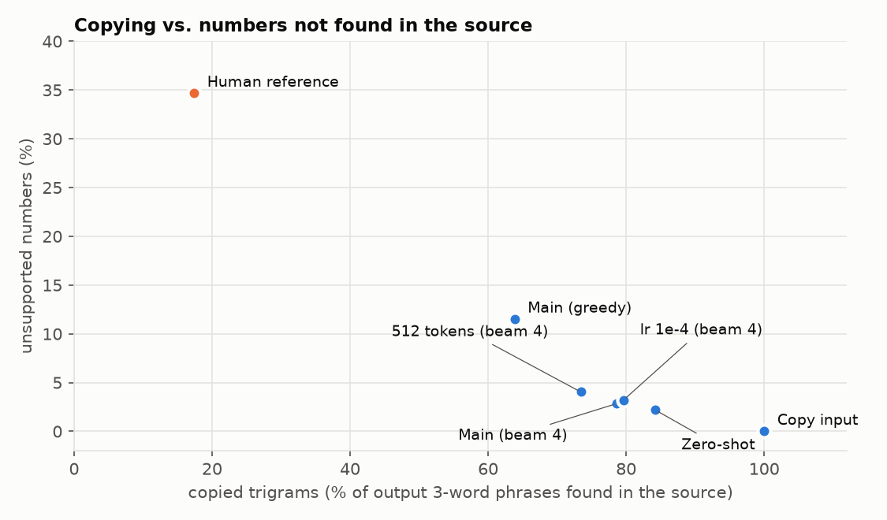

# Medical Text Simplifier — Project Report

Khaled Elsissi · November 26, 2026

## 1. Introduction

A fine-tuned FLAN-T5-base model turns medical review abstracts into shorter, more readable plain-language summaries: it raises SARI from 33.6 to 37.9 over the untrained model and lowers the reading grade by about one level, but it simplifies mainly by selecting and shortening sentences rather than rewriting jargon.

Medical research is written for doctors and scientists. Patients who read it meet dense terms ("risk ratio", "allocation concealment") and long sentences full of statistics. The goal of this project is a generative model that rewrites such text in plain language.

The project targets a pre-trained Transformer fine-tuned for conditional text generation. The model is `google/flan-t5-base`, a 250-million-parameter encoder-decoder. It is trained on paragraph-level pairs of Cochrane review abstracts and the plain-language summaries written for the same reviews.

This report covers the data, the training method, the hyperparameter combinations tried and their effect on training, the evaluation on a held-out test set, and a discussion of what the model learned and where it fails. All code, configurations, logs and predictions are in the project repository ([github.com/sissikhaled/medical-text-simplifier](https://github.com/sissikhaled/medical-text-simplifier)).

## 2. Data

The model is trained on 4,458 abstract/summary pairs from the Cochrane paragraph-level simplification corpus ([Devaraj et al., 2021](https://github.com/AshOlogn/Paragraph-level-Simplification-of-Medical-Texts), CC BY 4.0). Each pair joins the technical abstract of a Cochrane systematic review with the plain-language summary written for the same review.

| Split | Pairs | Use |
| --- | --- | --- |
| Train | 3,567 | weight updates |
| Validation | 411 | early stopping and model selection |
| Test | 480 | final evaluation, used once per system |

The official split of the authors was downloaded from a pinned commit and checked for empty fields, duplicates and leakage between splits; none were found. One training pair whose summary was identical to its abstract (a scraping error) was removed, because it would teach copying.

**Lengths and readability.** Measured in FLAN-T5 tokens, abstracts have a median of 491 and a maximum of 1,165; summaries a median of 265. A 512-token input limit would cut 47% of the abstracts, a 1024-token limit only 2.5%. The summaries are easier to read than the abstracts (Flesch-Kincaid grade 13.8 vs. 15.3 on the training set), but still at university level. The model can only learn the level of simplicity its references have.

**Preprocessing.**

- **Readability fix.** The standard `textstat` FKGL treats every full stop as a sentence end, so decimals ("RR 0.85") and abbreviations ("et al.") split abstracts into fake short sentences and made them look *easier* than the summaries. All FKGL values in this report use a corrected version that hides those dots first.
- **Symbol normalization.** 16.7% of abstracts contained characters the T5 tokenizer cannot represent (−, <, ±, µ, ≥, Greek letters). They were rewritten as ASCII words ("less than", "+/-", "micro"), the same way in sources and targets, which brought unknown tokens from 2,208 to 0. Without this, statements like "P < 0.05" would lose their meaning.

## 3. Training methodology

All weights of FLAN-T5-base were fine-tuned with teacher forcing and token-level cross-entropy loss, using the Hugging Face `Seq2SeqTrainer`. The encoder reads `simplify: ` followed by the abstract; the decoder learns to produce the reference summary token by token.

| Setting | Main configuration | Reason |
| --- | --- | --- |
| Model | `google/flan-t5-base` (250M parameters) | Instruction-tuned T5; fits a free 16 GB GPU |
| Input / output length | 1024 / 768 tokens | Cuts 2.5% of abstracts and 0.7% of summaries |
| Optimizer | AdamW, weight decay 0.01, gradient clipping 1.0 | Standard for Transformer fine-tuning |
| Learning rate | 3e-4, 5% linear warm-up, then linear decay | Common for T5; warm-up avoids large early updates |
| Batch | 4 per step × 4 accumulation steps = 16 | Largest that fits a T4 with 1024-token inputs |
| Epochs | up to 10, early stopping with patience 2 on validation loss | Stops when the model starts to overfit |
| Precision | fp32 | T5 overflows in fp16; the T4 has no bf16 |
| Memory | activation checkpointing | About 20% slower, much less memory |
| Seed | 42 | Repeatable data order and initialization |

After each epoch the trainer computed the validation loss and saved a checkpoint. The checkpoint with the lowest validation loss was kept as the final model.

**Hardware.** A Mac M2 (16 GB, MPS) was used for development and a 4-minute end-to-end smoke test on 200 pairs. The smoke test confirmed that loss falls, that the best model reloads with the same validation loss, and that generation works. Full training ran on Google Colab T4 GPUs at about 9 s per optimizer step, or 35 minutes per epoch. Checkpoints went to Google Drive so that a disconnected session could resume.

**Two implementation details mattered.** First, transformers 5.x logs the training loss summed over the 4 accumulation steps, so logged values were divided by 4 for the curves. Second, an interrupted run must resume from a checkpoint that includes the optimizer and learning-rate scheduler state. Section 4 describes what happened when one did not.

## 4. Hyperparameter combinations and their effect on training

The main configuration gave the lowest validation loss; a 3× smaller learning rate trained more slowly and ended slightly worse, and cutting inputs to 512 tokens was clearly worse. Each variation changes exactly one setting of the main configuration.

| Run | Changed setting | Epochs run | Stopped by | GPU time (T4) |
| --- | --- | --- | --- | --- |
| Main | – | 6 | early stopping | 3.5 h |
| Learning rate 1e-4 | learning rate 3e-4 → 1e-4 | 10 | epoch limit | about 6 h |
| Inputs cut to 512 | input length 1024 → 512 tokens | 6 | early stopping | 2.7 h |

*Validation loss after each epoch, from `runs/*/log_history.csv`.*

**Learning rate.** With 3e-4 the validation loss bottomed out at epoch 4, and early stopping ended the run two epochs later, as training loss kept falling (from 2.56 to about 1.6) while validation loss stayed flat: the start of overfitting. With 1e-4 the model learned more slowly, needed all 10 epochs and still ended above the main run. It overfit less (smaller gap between training and validation loss) but never reached a lower validation loss, and it cost almost twice the GPU time.

**Input length.** Cutting inputs at 512 tokens hides the end of the abstract, usually the results section, for 47% of the training pairs. Its curve has the same shape as the main run but sits about 0.08 higher throughout. The gap therefore comes from the missing input, not from different training dynamics. In a validation sample whose results section was cut off, this model wrote statistics that do not exist in the source ("27 studies, 78 patients" for a review of 4 studies).

**A resume problem in the learning-rate run.** The Colab session for this run ended after epoch 5 and was resumed. The loss log showed the learning rate dropping to nearly zero and warming up again. The checkpoint on Google Drive had been saved without its optimizer file, most likely because the session died before the 2 GB file finished uploading. The training library then silently started a new optimizer and schedule. Validation loss kept improving after the restart, so the run was kept and the deviation documented. The resume code was changed to use only complete checkpoints and to stop with an error otherwise; the 512-token run trained without interruption.

## 5. Evaluation setup

Every system generated one output for each of the 480 test abstracts and was scored against the human plain-language summary with the same metrics. The test set was not used for any training or model choice.

**Systems compared.**

- **Copy input:** the abstract itself. It shows what a system that changes nothing scores.
- **Zero-shot FLAN-T5-base:** the untrained model with the instruction "Rewrite the following medical text in plain language that a patient without medical training can understand". It shows what fine-tuning adds.
- **The three fine-tuned runs**, each with beam search (4 beams).
- **The main run with greedy decoding**, to measure the effect of the decoding method without retraining.

Generation used `no_repeat_ngram_size=3` and up to 768 new tokens. Beam search keeps the 4 most likely partial outputs at each step; greedy keeps only the single most likely next token.

**Metrics.**

- **SARI** (0–100), the standard simplification metric. It compares the output with both the source and the reference, and is the mean of three parts: words correctly *kept*, correctly *deleted* and correctly *added*. All three parts are reported, for a reason shown in Section 6.
- **BLEU** and **ROUGE-L** (0–100): word overlap with the reference.
- **FKGL** (Flesch-Kincaid grade level, lower is easier), with the corrected sentence splitting from Section 2.
- **Copied trigrams** (added for this project): the share of the output's 3-word phrases found word for word in the source. It measures how much a system copies rather than rewrites.
- **Unsupported numbers** (added for this project): the share of numbers in the output that appear nowhere in the source. For medical text this is a simple warning sign for invented statistics. Spelled-out numbers are not counted.

**Significance.** Differences between systems were tested with a paired bootstrap: the 480 test examples were resampled with replacement 2,000 times, and a difference counts as real when its 95% interval excludes zero.

## 6. Results

Fine-tuning raised SARI from 33.6 (zero-shot) to 37.9 and lowered the reading grade from 15.15 to 14.07, but the outputs still copy 79% of their 3-word phrases from the source, against 17% for the human writers.

| System | SARI | BLEU | ROUGE-L | FKGL (lower = easier) | Words | Copied trigrams (%) | Unsupported numbers (%) |
| --- | --- | --- | --- | --- | --- | --- | --- |
| Copy input | 41.81 | 14.47 | 25.79 | 15.15 | 350 | 100.0 | 0.0 |
| Zero-shot FLAN-T5 | 33.63 | 0.46 | 14.29 | 13.99 | 44 | 84.2 | 2.2 |
| **Main (beam 4)** | **37.90** | 14.78 | 25.54 | 14.07 | 184 | 78.6 | 2.8 |
| Main (greedy) | 38.76 | 14.89 | 25.59 | 13.56 | 205 | 63.8 | 11.5 |
| Learning rate 1e-4 (beam 4) | 37.84 | 15.03 | 25.64 | 14.26 | 191 | 79.6 | 3.2 |
| Inputs cut to 512 (beam 4) | 37.74 | 13.09 | 24.87 | 13.89 | 172 | 73.4 | 4.0 |
| Human summaries | – | – | – | 13.63 | 215 | 17.4 | 34.7 |

**Fine-tuning versus the untrained model.** SARI rose by 4.3 points (95% interval +3.7 to +4.8), BLEU from 0.5 to 14.8 and ROUGE-L from 14.3 to 25.5. The zero-shot model only returned one or two sentences of the abstract (44 words); the fine-tuned model writes summary-length text (184 words, against 215 for the human summaries).

**Why copying the input has the highest SARI.** Copying beats the main model by 3.9 SARI points (interval −4.4 to −3.4). The figure below shows why: the SARI implementation scores "deleted nothing" as a perfect deletion (0/0 = 1), so copying gets 100 on *delete* for free. A system that shortens a 350-word abstract to 184 words will also delete words the reference kept, and loses points there. On the two parts that measure real work, the fine-tuned model beats copying: *keep* 28.5 vs. 25.4 and *add* 2.4 vs. 0.

*SARI parts on the 480 test pairs, from `runs/*/metrics.json`. Each panel has its own scale.*

**Readability.** The mean grade fell by 1.08, which covers about 70% of the 1.52-grade gap between the abstracts and the human summaries. 77% of the outputs are easier to read than their own source (median change −0.84 grades).

**Copying.** The model simplifies mainly by selecting and shortening: 79% of its 3-word phrases come word for word from the source, and its *add* score is low (2.4). It did learn some conventions of plain summaries, such as opening with "We searched for…" or "We included…" and explaining what a randomised controlled trial is.

**Decoding.** Greedy decoding scored significantly higher SARI than beam search (+0.86, interval +0.48 to +1.24), read easier (grade 13.56) and copied less (64%). But 11.5% of its numbers were not in the source, four times the rate of beam search. In one test abstract, greedy wrote 16 unsupported numbers where beam search wrote none.

**The two training variations.** On the whole test set, neither differs significantly from the main model (SARI difference +0.07 for the learning rate and +0.17 for the input length; both intervals include zero). The effect of input length appears where it should: on the 235 test abstracts longer than 512 tokens, the main model scores +0.56 SARI higher (interval +0.08 to +1.02) and writes fewer unsupported numbers (3.0% vs. 4.4%). On the shorter abstracts, where nothing is cut, the two models are equal.

**Errors in the outputs.** Examples chosen automatically (highest, median and lowest SARI, most unsupported numbers) show three kinds of error and one weakness of the metric:

- A changed unit: "400 mcg versus 200 **mg**" (the source says 200 mcg).
- A lost fact: "We found **seven** studies, but only seven met our inclusion criteria" (the source found 18 and included 7).
- Misspelled rare names ("Amiriptylline", "bruxxism"): the model builds rare words from sub-word pieces and sometimes joins them wrongly.
- Near-copies scored well: the highest-SARI example is almost a copy of its abstract, because its human summary also copied a long list of funders.

## 7. Discussion

The model learned to *condense* medical abstracts faithfully, but not to *rewrite* them in plain words; the training objective, the data and the metrics all push in that direction.

**Why it copies.** Training minimizes cross-entropy against one reference, word by word. Many reference words also occur in the abstract, so copying them is a low-risk way to lower the loss. A new plain word is a gamble: if the reference used a different one, the model is penalized. The result is a model that chooses which sentences to keep and trims them, which is what the low *add* score and the 79% copied trigrams show.

**What the references teach.** The human summaries are themselves at university reading level (grade 13.6). They also contain facts the model cannot see: 35% of their numbers do not appear in the abstract, because the summaries were written from the full reviews. Training on these pairs partly rewards writing numbers that are not in the input. This is a plausible contributor to invented statistics, together with cut-off inputs and greedy decoding.

**What the metrics can and cannot show.** At paragraph level, SARI's free deletion score makes copying the best system on paper, and BLEU and ROUGE-L barely separate copying (25.8 ROUGE-L) from the fine-tuned model (25.5). Reading only the headline SARI would lead to the wrong conclusion that fine-tuning made things worse. Splitting SARI into its parts and adding the copying and unsupported-number measures gave a more truthful picture.

**Faithfulness matters more than a higher score.** For patients, a wrong number or unit is worse than a long sentence. This is why beam search stayed the default although greedy decoding scored higher, and why the demo flags every number in the output that is not in the input. The check catches invented numbers, but not a changed unit or a dropped fact.

**Domain.** The model was trained on Cochrane review abstracts. On a short clinical note (a COPD flare-up with a prescription), it kept the first two sentences, dropped the treatment plan and produced harder text (grade 12.5 to 14.1). Explaining clinical notes to patients would need different, patient-oriented training data.

**Demo.** A local Gradio app (`python -m app.app`) runs the main model on a laptop in about 2 to 8 seconds per abstract. It shows the simplified text, the reading grade of input and output, and a warning listing any numbers not found in the input.

## 8. Limitations and future work

The evaluation is automatic and the model is small, so the results show clear trends but not how well real patients would understand the outputs.

**Limitations.**

- No human evaluation: fluency, faithfulness and simplicity were not judged by people.
- One reference summary per abstract; many good simplifications exist that share few words with it.
- FKGL measures sentence and word length, not whether a term is understood.
- "Unsupported numbers" is a rough proxy: it misses wrong statements without numbers and counts correct reformulations (such as rounding) as unsupported.
- One training run per configuration: differences in validation loss smaller than about 0.01 may be seed noise. The learning-rate run also had an unplanned learning-rate restart (Section 4).

**Future work.**

1. **Penalize jargon or copying during training**, for example with the unlikelihood loss proposed by Devaraj et al. (2021) for technical terms.
2. **Filter the training pairs** whose summaries contain facts missing from the abstract, to reduce the incentive to invent numbers.
3. **A larger model** (FLAN-T5-large or an instruction-tuned decoder model) trained with parameter-efficient methods such as LoRA, to fit a free GPU.
4. **Sentence-level, patient-oriented data** (for example the PLABA dataset of plain-language adaptations of biomedical abstracts), which simplifies more aggressively than the Cochrane summaries.
5. **A small human evaluation** with non-expert readers rating fluency, faithfulness and simplicity.

## References

- Devaraj, A., Marshall, I. J., Wallace, B. C. and Li, J. J. (2021). *Paragraph-level Simplification of Medical Texts.* NAACL 2021. Data and code: [github.com/AshOlogn/Paragraph-level-Simplification-of-Medical-Texts](https://github.com/AshOlogn/Paragraph-level-Simplification-of-Medical-Texts).
- Chung, H. W. et al. (2022). *Scaling Instruction-Finetuned Language Models.* (FLAN-T5)
- Raffel, C. et al. (2020). *Exploring the Limits of Transfer Learning with a Unified Text-to-Text Transformer.* JMLR. (T5)
- Xu, W., Napoles, C., Pavlick, E., Chen, Q. and Callison-Burch, C. (2016). *Optimizing Statistical Machine Translation for Text Simplification.* TACL. (SARI)
- Kincaid, J. P. et al. (1975). *Derivation of New Readability Formulas for Navy Enlisted Personnel.* (Flesch-Kincaid grade level)
- Wolf, T. et al. (2020). *Transformers: State-of-the-Art Natural Language Processing.* EMNLP System Demonstrations. (Hugging Face Transformers)
- Project repository: [github.com/sissikhaled/medical-text-simplifier](https://github.com/sissikhaled/medical-text-simplifier) (code, configurations, logs, predictions, analysis notebook).
